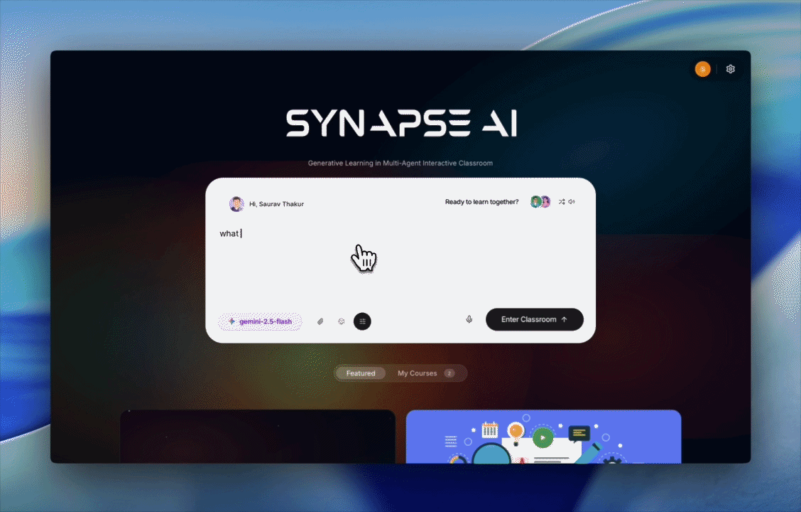
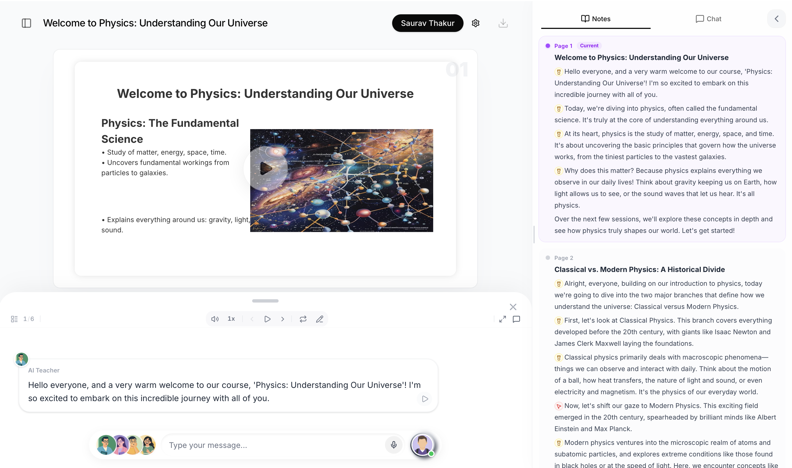
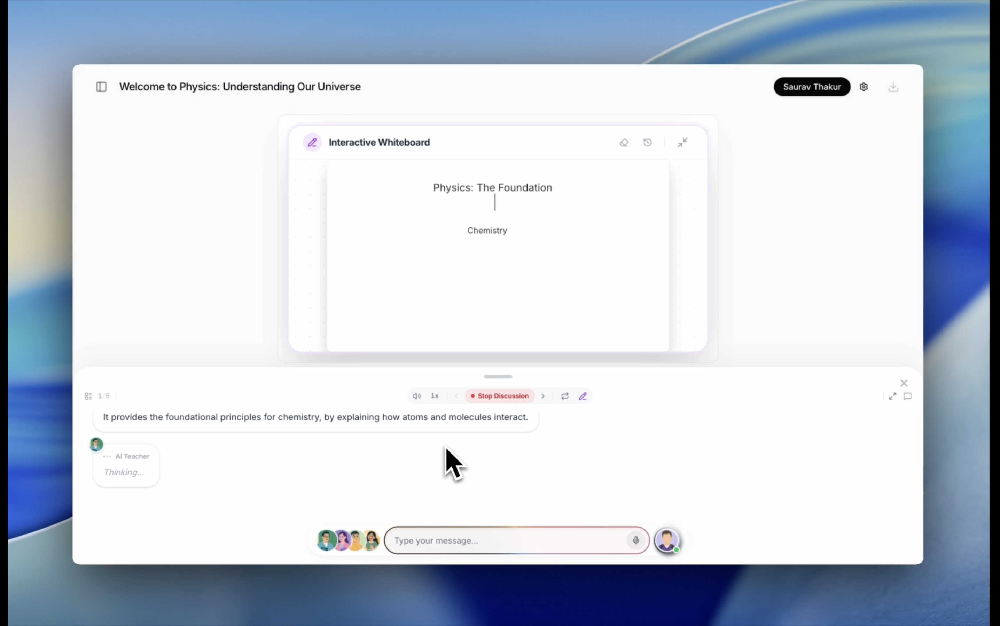
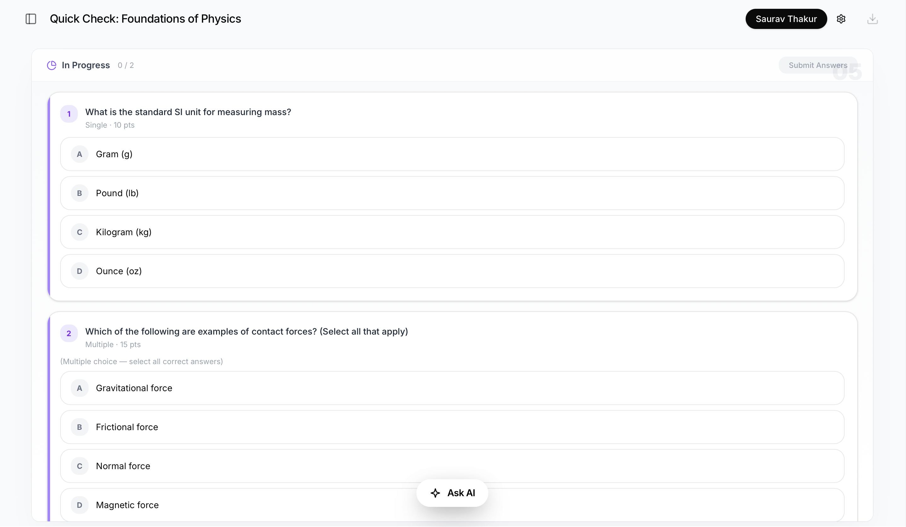

<div align="center">
  <br />
  <h1 align="center">SYNAPSE AI</h1>
  
  <p align="center">
    <strong>Multi-Agent AI • Video Generation • Intelligent Workspace</strong>
  </p>

  <p align="center">
    A production-oriented, open-source AI workspace.
  </p>

  <p align="center">
    <a href="https://ai.nexbook.tech"></a>
    <a href="https://github.com/sauravthakurq/SYNAPSE-AI/stargazers"></a>
    <a href="https://github.com/sauravthakurq/SYNAPSE-AI/network/members"></a>
    
  </p>

  <br />
  
  <br />
</div>

<br/>

> **🚀 Open-Source Intelligence:** Synapse AI integrates the absolute best of LLM orchestration, vision parsing, web search, real-time audio, and multi-agent systems into a beautifully architected Next.js 16 environment.

---

## 💡 Why Synapse AI?

Most AI tools are fragmented. You use:

- One app for chat  
- One app for video generation  
- One app for notes & whiteboarding  
- One app for reading PDFs  

**Synapse unifies everything into one intelligent, context-aware ecosystem.**

---

## ⚡ Core Features

- 🤖 **Multi-Agent Classroom**  
  Simulates real-world discussion with multiple AI perspectives interacting with each other.

- 🎬 **Autonomous Video Engine**  
  From prompt → storyboard → dynamic rendered output right in the workflow.

- 🧠 **Contextual Knowledge System**  
  Rich text notes, infinite whiteboards, and AI chat unified in one memory layer.

- 🔊 **Neural Voice Synthesis**  
  Studio-quality TTS via Microsoft Azure & ElevenLabs with customizable phonetic control.

- 📄 **Deep Document Intelligence**  
  Query entire multi-hundred page PDFs with unPDF/MinerU structured semantic understanding.

- 🌐 **Real-Time Web Search**  
  Agentic routing to fetch live facts and source credible citations dynamically.

- ⚙️ **Fail-Proof API Layer**  
  Smart fallback routing across OpenAI, Anthropic, Google, and Open-Weights models.

---

## 🌟 Visual Showcase

### 🕹️ Autonomous Video Dashboard
An extremely powerful underlying engine automating the complex process of video compilation, timing, and multi-agent coordination.
<div align="center">
  
</div>

---

### 🎥 Seamless Interactive Playback
Generate, view, and interact with dynamic media right within your workflow. Integrated player supports instant playback.
<div align="center">
  
</div>

---

### 📱 A True Mobile-First Experience
Rigorously designed for flawless execution on any device. Fluid typography, buttery-smooth drawers, and uncompromised UI logic.
<div align="center">
  
</div>

---

### 💬 The Intelligent Chatbar
Absolute command over the AI. Switch contexts, trigger media generation, and toggle system commands instantly.
<div align="center">
  
</div>

---

### 📝 Smart Notes & Visualization
Synthesize ideas dynamically. AI-assisted annotations and structural layouts mapped directly alongside your chat sessions.
<div align="center">
  
</div>

---

### 🧠 Interactive Quizzes
System-generated contextual assessments mapped precisely to your ongoing coursework and document inputs.
<div align="center">
  
</div>

---

## 🧠 System Architecture

Synapse AI leverages a heavily optimized Director-Worker proxy pattern for flawless multi-model execution.

### `Multi-Agent Flow`
1. **Director Agent:** Analyzes intent, routes web-search vs. generation, and provisions subsystems.
2. **Worker Agents:** Execute atomic tasks (e.g., vision parsing, chart generation, contrarian dialogue).
3. **Aggregator & Synthesis:** Normalizes tool outputs and orchestrates timing.
4. **Real-time UI Sync:** Streams binary frames and markdown seamlessly to the front-end canvas.

---

## 🚀 Deploy Instantly

Deploy your own instance of the workspace to Vercel in 1-Click.

<a href="https://vercel.com/new/clone?repository-url=https://github.com/sauravthakurq/SYNAPSE-AI">
  
</a>

---

## 💻 Quick Start (Local Setup)

```bash
# 1. Clone the repository
git clone https://github.com/sauravthakurq/SYNAPSE-AI.git
cd SYNAPSE-AI

# 2. Install dependencies (PNPM is strictly required)
corepack enable pnpm
pnpm install

# 3. Setup environment configuration
cp .env.example .env.local

# 4. Initialize development server
pnpm dev
# Server live at: http://localhost:3000
```

---

## 🧩 Environment Variables

Configure your `.env.local` to securely pass keys to the server logic.

```bash
# Required API Keys
OPENAI_API_KEY=
ANTHROPIC_API_KEY=
GOOGLE_API_KEY=
ELEVENLABS_API_KEY=

# Optional (for full auth/system capabilities)
NEXT_PUBLIC_APP_URL=https://ai.nexbook.tech
```

---

## 📁 Project Structure

Built on standard Next.js 16 paradigms for instantaneous senior-level onboarding.

```text
SYNAPSE-AI/
├── app/                # Next.js App Router (Pages, Generative AI Routes)
├── components/         # Modular, reusable UI components (Radix + Tailwind)
├── lib/                # Core orchestration logic, orchestration, & utils
├── public/             # Static assets, branding, and optimized media
├── hooks/              # Custom React 19 lifecycle & state hooks
├── configs/            # Global theme, routing, and constant configurations
└── types/              # Strict TypeScript definition payloads
```

---

## 🔐 Security

- Keep provider secrets in server-side environment variables; never commit them.
- Server-side routes validate user-supplied fetch URLs to reduce SSRF risk.
- Rotate provider keys in your hosting dashboard if a key may have been exposed.


---

## 🗺️ Roadmap

- [ ] Universal Plugin System
- [ ] Visual Custom Agent Builder
- [ ] WebRTC Real-Time User Collaboration
- [ ] Dedicated Native Mobile App wrap

---

## 🤝 Contributing

We welcome structural improvements, bug fixes, and feature additions!

### Steps:
1. Fork the repository
2. Create a new branch (`git checkout -b feature/your-feature`)
3. Commit your changes strictly following conventional commits
4. Push to the branch (`git push origin feature/your-feature`)
5. Open a Pull Request

### Guidelines:
- Preserve **TypeScript strict mode**.
- Adhere strictly to the existing App Router structures.
- Ensure all CI/CD formatting steps pass locally before pushing.

---

## 🧾 Maintainer and attribution

Synapse AI is maintained and extended by **Saurav Thakur**. This repository includes MIT-licensed open-source components and preserves required license notices and historical contributor credits. See [UPSTREAM_ATTRIBUTION.md](UPSTREAM_ATTRIBUTION.md).

---

## 📜 License

MIT License © Saurav Thakur.  
Free to modify and utilize for personal or enterprise workloads under standard attribution.

---

## 👤 Author

**Saurav Thakur**  
*AI Engineer | Founder | Built 46+ AI systems*

An expert in AI, GenAI, and Agentic Systems, Saurav has developed 21+ apps and built 4 AI startups, delivering innovative automation tools currently serving over 22,000+ users worldwide.

---

## ⭐ Support the Project

If you found this useful, consider giving it a star — it helps open-source thrive!
