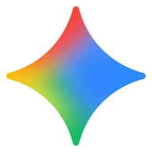

<div align="center">
  

  <h1 align="center" style="font-size: 3rem; margin-top: 20px;">
    Synapse AI 🧠
  </h1>

  <p align="center" style="font-size: 1.2rem; color: #555;">
    <strong>The Ultimate Unified Intelligence Interface.</strong><br/>
    Seamlessly chat, generate PPTs, read PDFs, synthesize voices, and create rich media all from one flawless view.
  </p>

  <p align="center">
    <a href="#"></a>
    
    
    
    
  </p>
  
  <p align="center">
    <a href="#-core-features"><b>Features</b></a> •
    <a href="#-the-neural-network-supported-models"><b>AI Models</b></a> •
    <a href="#-quick-start"><b>Installation</b></a> •
    <a href="#-tech-stack"><b>Tech Stack</b></a>
  </p>
</div>

<br/>

> **🚀 Welcome to the Future of Work:** Synapse AI is not just another chatbot interface. It's a full-stack, enterprise-grade AI OS built on Next.js 15. We integrate the best large language models, vision APIs, PDF parsers, and TTS engines into an elegant, user-centric workspace.

---

## ✨ Core Features

<table>
  <tr>
    <td align="center" width="50%">
      <h3>💬 Omni-Channel Chat</h3>
      <p>Talk natively to OpenAI, Claude, Gemini, DeepSeek, and Grok without jumping between tabs.</p>
    </td>
    <td align="center" width="50%">
      <h3>🎨 Visual Canvas & PPTX</h3>
      <p>Need a presentation? Synapse generates stunning slides and exports directly to `.pptx` or `.docx`.</p>
    </td>
  </tr>
  <tr>
    <td align="center" width="50%">
      <h3>📄 Deep-Dive Document Parsing</h3>
      <p>Powered by MinerU & UnPDF. Upload 100-page reports and query every graph, table, and paragraph instantly.</p>
    </td>
    <td align="center" width="50%">
      <h3>🎙️ Studio-Grade Audio</h3>
      <p>High-fidelity text-to-speech utilizing Microsoft Azure AI Voices and ElevenLabs for realistic narration.</p>
    </td>
  </tr>
  <tr>
    <td align="center" width="50%">
      <h3>🌐 Infinite Web Canvas</h3>
      <p>Real-time internet search capabilities via Perplexity-like routing to keep the AI's knowledge completely fresh.</p>
    </td>
    <td align="center" width="50%">
      <h3>🎬 Automated Media & Image Gen</h3>
      <p>Generate production-ready art, diagrams, and iterative video drafts securely from the chat stream.</p>
    </td>
  </tr>
</table>

---

## 🧠 The Neural Network: Supported Models

Integrating practically **every cutting-edge model** currently on the market. Define your own API keys securely on the client or server. 

<div align="center">

| Tier 1 Giants | The Open-Weights Vanguard | Voice & Specialized Tasks |
| :---: | :---: | :---: |
| <br/>**OpenAI** (GPT-4o) | <br/>**DeepSeek** (V3/R1) | <br/>**Azure TTS Voices** |
| <br/>**Anthropic** (Opus/Sonnet) | <br/>**Alibaba Qwen** | <br/>**ElevenLabs API** |
| <br/>**Google Gemini** (1.5 Pro) | <br/>**X.AI Grok** | <br/>**MiniMax** |

*Plus native support for: Bailian, Doubao, GLM, Kimi, Kling, SiliconFlow & many more...*

</div>

---

## ⚡ Quick Start

Deploy this beast on your local machine in under **2 minutes**.

### 1. Clone the Repository
```bash
git clone https://github.com/sauravthakurq/SYNAPSE-AI.git
cd SYNAPSE-AI
```

### 2. Install Dependencies (PNPM Required)
We use `pnpm` for blazing-fast, strictly-resolved package installation.
```bash
corepack enable pnpm
pnpm install
```

### 3. Environment Variables
Copy the template and fill in your API tokens.
```bash
cp .env.example .env.local
```

### 4. Ignite the Engines
```bash
pnpm dev
# The studio is now live at http://localhost:3000
```

---

## 🏗️ Tech Stack

Synapse AI is constructed on a hyper-modern, bleeding-edge foundation to ensure 0-latency perceived performance.

- **Framework:** [Next.js 15](https://nextjs.org/) (App Router, Turbopack)
- **UI & Components:** [React 19](https://react.dev/), [Tailwind CSS](https://tailwindcss.com/)
- **Theme Ecosystem:** [Radix UI](https://www.radix-ui.com/), [Framer Motion](https://www.framer.com/motion/)
- **State Management:** [Zustand](https://zustand-demo.pmnd.rs/) with persist middleware
- **AI Core Engine:** [Vercel AI SDK](https://sdk.vercel.ai/)
- **Export & File Systems:** `pptxgenjs`, `mammoth`, `jspdf`

---

## 🛡️ License & Acknowledgements

<div align="center">
  <p>Released under the <b>MIT License</b>.</p>
  
</div>
